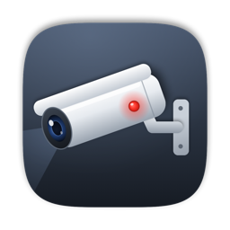

<div align="center">



# Open-source CCTV App for macOS

**Watch your home cameras live, scrub through the NVR's recordings and get motion alerts —<br>
in a fast, native Mac app that never stores video on your Mac.**

[](https://github.com/sujitjadhav/CCTV-App-for-MacOS/releases/latest)
[](https://github.com/sujitjadhav/CCTV-App-for-MacOS/releases)
[](#requirements)
[](App)
[](LICENSE)
[](https://github.com/sujitjadhav/CCTV-App-for-MacOS/actions/workflows/release.yml)

<br>

<a href="https://github.com/sujitjadhav/CCTV-App-for-MacOS/releases/latest">
  
</a>

<sub>Free · macOS 14 Sonoma or newer · Apple Silicon · for XMEye-based NVRs (e.g. Securus Crimson)</sub>

</div>

---

## ✨ Features

<table>
<tr>
<td width="50%" valign="top">

### 🎥 Live view
1×1, 2×2 and 1 large + 3 small layouts. The grid uses light substreams; the big camera switches to
**HD**. Double-click for full size, <kbd>Esc</kbd> to go back. Sound on/off per camera.

</td>
<td width="50%" valign="top">

### ⚡ Fast and light
FFmpeg + Apple **VideoToolbox** GPU decoding, frames shown the moment they arrive.
Streams pause when the window is hidden or the Mac sleeps.

</td>
</tr>
<tr>
<td valign="top">

### 🗂 Recordings from the NVR
Pick a camera and day, see a **24-hour timeline**, click to jump. Plays in a second or two at
**1× · 2× · 4× · 8×**, with a full-size view. Streams straight from the NVR's hard disk.

</td>
<td valign="top">

### 🔔 Motion alerts
NVR motion/alarm events as macOS notifications, per-camera toggles and quiet hours. Click an alert to
watch live, or open the recording from the event log.

</td>
</tr>
<tr>
<td valign="top">

### 🎛 Camera settings
Image (brightness, exposure, BLC, WDR-style highlight control, mirror/flip), day/night and light control,
**video quality** (codec, resolution, fps, bitrate), **privacy masks** and **motion areas** drawn on the
picture, person/tamper detection, a painted **weekly recording schedule**, copy to other cameras and backups.

</td>
<td valign="top">

### 🏢 Many cameras, many NVRs
Up to **100 cameras** per NVR with 1, 2×2, 3×3, 4×4, 5×5, 1+3 and 1+5 layouts and pages, and any number of
NVRs (home, shop, office) with alerts from all of them.

</td>
</tr>
<tr>
<td valign="top">

### 🧭 Menu bar
Camera previews and recent alerts one click away. Keeps running when the window is closed;
optional **open at login**. A **Device** page shows the NVR's model, firmware, network and disk usage.

</td>
<td valign="top">

### 🔒 Private by design
**Nothing is recorded or saved on your Mac.** The password lives in the macOS **Keychain** and is never
logged. Live status badges and auto-reconnect keep everything up.

</td>
</tr>
</table>

---

## 📦 Install

1. **[Download the latest `.dmg`](https://github.com/sujitjadhav/CCTV-App-for-MacOS/releases/latest)**, open it and drag **CCTV** into **Applications**.
2. Open **CCTV**. The first time, macOS asks you to confirm (see below).
3. Go to **Settings**, enter your NVR's **IP address**, **username** and **password**, click **Test Connection**, then **Save**.
4. Click **Allow** when macOS asks for **Local Network** access.

<details>
<summary><b>"Apple could not verify CCTV…" — how to open it the first time</b></summary>

<br>

This free build isn't notarized by Apple, so macOS asks once:

- **macOS 15 Sequoia or newer:** click **Done**, open **System Settings → Privacy & Security**, scroll down
  and click **Open Anyway** next to CCTV.
- **macOS 14 Sonoma:** right-click **CCTV** in Applications → **Open** → **Open**.
- Or in Terminal: `xattr -dr com.apple.quarantine /Applications/CCTV.app`

</details>

<details>
<summary><b>Local Network access was denied</b></summary>

<br>

CCTV shows a banner if macOS blocks it. Turn it back on in **System Settings → Privacy & Security →
Local Network → CCTV**.

</details>

### Requirements

| | |
| --- | --- |
| **Mac** | macOS 14 Sonoma or newer · Apple Silicon (Intel: build from source) |
| **NVR / DVR** | XMEye / Xiongmai-based, reachable on your network |
| **Ports** | RTSP **554** (live) · DVRIP **34567** (recordings, alerts) |

---

## 🔌 Compatibility

Live view uses the XMEye RTSP format:

```
rtsp://USER:PASS@IP:554/user=USER&password=PASS&channel=N&stream=S.sdp   (N = channel, S = 0 main / 1 sub)
```

Recordings and alerts use the XMEye **DVRIP / Sofia** protocol on port 34567, implemented in
[`App/DVRIP.swift`](App/DVRIP.swift) following [OpenIPC/python-dvr](https://github.com/OpenIPC/python-dvr).
Built and tested with a **Securus Crimson** NVR (RTSP server "H264DVR 1.0"); many Xiongmai-based NVRs/DVRs
sold under other brands should work. Camera settings use the NVR's own config names (`Camera.Param`,
`Simplify.Encode`, `Detect.MotionDetect`, `Record`, …); anything a camera doesn't report is hidden.

---

## 🛠 Build from source

```bash
xcode-select --install          # Apple command line tools
brew install ffmpeg             # or: tools/build_ffmpeg.sh  (small LGPL build, no Homebrew needed)

git clone https://github.com/sujitjadhav/CCTV-App-for-MacOS.git
cd CCTV-App-for-MacOS
./build.sh                                  # → build/CCTV.app
tools/bundle_ffmpeg.sh build/CCTV.app       # only with Homebrew FFmpeg: copy it into the app
cp -R build/CCTV.app /Applications/
```

<details>
<summary><b>Making a release</b></summary>

<br>

Publish a GitHub Release with a tag like `v1.0.1`. The **Release DMG** workflow
([`.github/workflows/release.yml`](.github/workflows/release.yml)) builds a minimal LGPL FFmpeg, the app and the
DMG on GitHub's Macs and attaches the DMG to the release. Locally, `tools/release.sh --adhoc --dmg` makes the
same DMG in `dist/`. For signed and notarized builds (no "Open Anyway" step) see [docs/SIGNING.md](docs/SIGNING.md).

</details>

<details>
<summary><b>Project layout</b></summary>

<br>

| Folder | What's inside |
| --- | --- |
| [`App/`](App) | SwiftUI app: live grid, recordings, events, settings, menu bar, Keychain, DVRIP client |
| [`Engine/`](Engine) | Objective-C + FFmpeg: low-latency RTSP playback, streaming playback of NVR recordings |
| [`tools/`](tools) | Fake NVR for testing, protocol tests, icon, FFmpeg build/bundling and release scripts |
| [`docs/`](docs) | Code signing and notarization guide |

</details>

<details>
<summary><b>Development and testing without a real NVR</b></summary>

<br>

```bash
python3 tools/fake_nvr.py --port 34568 --password test      # fake NVR with recordings and alarms
CCTV_FAKE_NVR=127.0.0.1:34568:test CCTV_SELFTEST=recordings build/CCTV.app/Contents/MacOS/CCTV
```

Other switches: `CCTV_STATS=1` (frames per camera), `CCTV_TEST_URL='udp://127.0.0.1:50{s}{ch}'` (local test
feeds instead of RTSP), `CCTV_SELFTEST=view|layouts`, `CCTV_IGNORE_VISIBILITY=1`. The protocol test suite is
described at the top of [`tools/dvrip_check.swift`](tools/dvrip_check.swift).

</details>

---

## 🔐 Privacy and security

- **No video on disk.** Live and recorded video stay in memory. The only file written is a small alert log
  (`~/Library/Application Support/CCTV/events.json`: time, camera, event type).
- **Password in the Keychain only.** Passwords and stream URLs (which contain the password) are never logged or shown.
- **Keep the NVR at home.** XMEye's RTSP and DVRIP protocols aren't encrypted, so don't expose ports 554 / 34567
  to the internet.

---

## 📄 License

[MIT](LICENSE) for this project's source code.

Release DMGs are built with a minimal **LGPL** [FFmpeg](https://ffmpeg.org) 9.0.2 (configured by
[`tools/build_ffmpeg.sh`](tools/build_ffmpeg.sh), linked statically; this repository has everything needed to
rebuild and relink it). A DMG built locally against Homebrew's FFmpeg includes GPL components (x264, x265) and
would have to be distributed under the GPL — see [docs/SIGNING.md](docs/SIGNING.md).

<div align="center">
<br>
<sub>Not affiliated with Securus, Xiongmai or XMEye. Use only with cameras and NVRs you own or are allowed to access.</sub>
</div>
